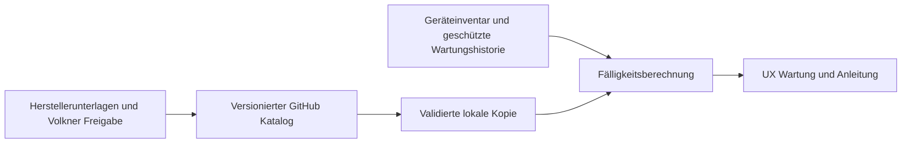

# Wartung und Service in Volkner UX

Stand 9. November 2026. Entwicklungsstand, noch keine vollständig freigegebene Wartungsplanung.

## Ziel

Fahrzeugbezogene Wartung für Heizung, Aufbau und sämtliche eingebauten Systeme in UX anzeigen. Der versionierte JSON-Katalog wird nach dem Prinzip der Fahrzeug-Bedienungsanleitung auf GitHub gepflegt. Die bestehende Anleitung bleibt kompatibel; der neue Bereich `maintenance/` hat eine eigene Version.

## Bedienung und Daten

Die erste UX-Ansicht zeigt alle acht Bereiche, filterbare Aufgaben und Quellen. Drei belegte Webasto-TTP50-Bausteine dienen als Start. Für weitere Geräte werden keine Intervalle erfunden. Ohne bestätigte Gerätezuordnung zeigt die Ansicht einen Katalog, keinen fahrzeugbezogenen Freigabestatus. Ein Datum lässt sich ausdrücklich als unverbindliche Fälligkeitsvorschau berechnen; es erzeugt keinen Wartungsnachweis.

Zielausbau: Inbetriebnahme und letzte Wartung je Geräteinstanz, Kilometer/Betriebsstunden mit Herkunft und Aktualität, Kalender- und Ereignisauslöser. Je nach Vorgabe löst die zuerst erreichte Grenze aus. Unbekannte oder veraltete Zähler ergeben keine grüne Freigabe. Vier Wochen sind 28 Tage; Monate werden als Kalendermonate mit Begrenzung auf den letzten gültigen Monatstag berechnet.

## Freigabe und Herkunft

Jede Regel braucht Hersteller/Typ, Varianten-/Baujahrzuordnung, Tätigkeit, Auslöser, Quellenrevision und Seite, Verantwortlichkeit und Freigabestatus. Herstellervorgabe, Herstellerempfehlung und eigene Volkner-Serviceempfehlung getrennt führen. Keine pauschale Jahresfrist für Aufbau, Heizung oder alle anderen Systeme ohne fachliche Grundlage. Die drei Startbausteine ersetzen nicht den vollständigen Wartungsumfang der Herstellerunterlagen.

## GitHub und Fahrzeugdaten

Das vorhandene Repository `realmxv/vehicle-manual` ist öffentlich. Dort dürfen allgemeine Regeln und Software liegen. Kundennamen, Fahrzeugnummern, Seriennummern und Wartungsnachweise gehören in den geschützten Fahrzeugdatensatz. Originalunterlagen nicht ohne geklärte Veröffentlichungsrechte hochladen. Updates müssen validiert und atomar übernommen werden, mit letzter gültiger Offline-Version, sichtbarem Quellenstand und Rückfall bei Fehlern. Der erste Stand enthält eine gebündelte Offline-Katalogkopie; automatisches Remote-Update ist noch nicht implementiert.

## Nächste Umsetzung und Abnahme

- Geräteinventar je Fahrzeug und Freigaben pflegen; drei gleiche Heizgeräte getrennt behandeln.
- Weitere belegte Herstellerintervalle und Volkner-Aufbauprüfungen ergänzen.
- Dauerhafte, berechtigte Wartungshistorie mit Datum, Prüfer, Befund und tatsächlich erledigten Prüfpunkten; Quittieren einer Meldung darf keine Wartung vortäuschen.
- Startseitenhinweise für bald fällig, fällig, überfällig und Klärungsbedarf ergänzen, sobald echte Fahrzeugdaten vorliegen.
- Offline-Updates, Rücknahme fehlerhafter Kataloge, Zählerausfall und doppelte Synchronisation prüfen.

Das Diagramm zeigt den Zielzustand. Der erste Stand ist eine lokale Katalogansicht mit Fälligkeitsvorschau, ohne Fahrzeug- oder Backend-Anbindung.

## Vorschau und Prüfung

Im Repository mit `python -m http.server 8080` einen lokalen Server starten und `http://localhost:8080/maintenance/preview.html` öffnen. Die Vorschau lädt nur den lokalen Katalog. Rechentests: `node maintenance/test.cjs`. Für den UX-Offline-Build `catalog.json` in eine lokale JavaScript-Zuweisung `window.VolknerMaintenanceCatalog = ...` umwandeln und vor `maintenance.js` einbinden.
